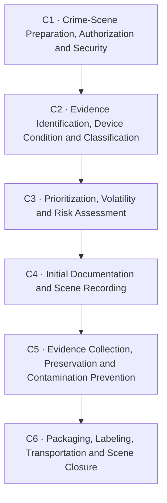

# Pillar 1 — Standardized Procedures

  <strong>Defining how digital evidence is handled at crime scenes</strong> 
  <em>Six connected components covering preparation, identification, prioritization, documentation, collection, and transportation</em>

  
  
  

---

## 1. Introduction

Pillar 1 — **Standardized Procedures** defines the procedural activities for handling digital evidence at a crime scene within the proposed research framework, *Enhancing the Integrity and Security of Digital Evidence in Pakistan*.

It addresses the question:

> **How should digital evidence be handled at the crime scene?**

The pillar is organized into six components (C1–C6). Together, these components describe the proposed crime-scene handling process, from preparation and evidence identification through collection, preservation, packaging, and documented authorized handover.

## 2. Purpose

The purpose of this pillar is to organize crime-scene digital evidence handling into clearly identified components. This structure is intended to support a consistent and documented approach to the activities covered by the framework.

The detailed activities and procedures for each component will be documented in its respective folder and supported by verified research sources and relevant guidance documents.

## 3. Procedural Overview

The six components are presented in the following order:

<caption>Figure 1. Overview of the six components in Pillar 1.</caption>

*The diagram presents the current component arrangement for documentation. The detailed procedures, decision points, and any operational dependencies will be established in the component-level research.*

## 4. Six Components

| ID | Component | Main focus |
|---|---|---|
| C1 | Crime-Scene Preparation, Authorization and Security | Preparing, authorizing, and securing the crime scene before evidence-handling activities. |
| C2 | Digital Evidence Identification, Device Condition and Classification | Identifying potential digital evidence and recording device condition and classification. |
| C3 | Digital Evidence Prioritization, Volatility and Risk Assessment | Assessing evidence priority, volatility, and relevant risks to guide handling decisions. |
| C4 | Initial Documentation and Scene Recording | Recording the scene, devices, and relevant initial observations. |
| C5 | Evidence Collection, Preservation and Contamination Prevention | Collecting and preserving digital evidence while reducing the risk of contamination or alteration. |
| C6 | Packaging, Labeling, Transportation and Scene Closure | Packaging, labeling, and securely transporting evidence, and documenting scene closure. |

### Component documentation

Each component has its own folder. Use the links below to access its documentation.

Component links

- [C1 — Crime-Scene Preparation, Authorization and Security](C1-Crime-Scene-Preparation/)
- [C2 — Digital Evidence Identification, Device Condition and Classification](C2-Evidence-Identification/)
- [C3 — Digital Evidence Prioritization, Volatility and Risk Assessment](C3-Prioritization-and-Risk-Assessment/)
- [C4 — Initial Documentation and Scene Recording](C4-Initial-Documentation/)
- [C5 — Evidence Collection, Preservation and Contamination Prevention](C5-Evidence-Collection-and-Preservation/)
- [C6 — Packaging, Labeling, Transportation and Scene Closure](C6-Packaging-and-Transportation/)

## 5. Component Documentation Template

To keep the component folders consistent, each detailed component document is intended to use the following structure:

| Section | What it should contain |
|---|---|
| Component Overview | Component title, identifier, and a concise explanation. |
| Purpose | The reason for including the component in the framework. |
| Scope | The activities and boundaries covered by the component. |
| Main Activities | The key activities associated with the component. |
| Detailed Procedures | The proposed steps and decision points, supported by verified sources. |
| Roles and Responsibilities | The roles responsible for performing, supervising, and documenting relevant activities. |
| Reference Standards | The specific source material supporting the component. |
| Verification and Documentation | The records or checks relevant to demonstrating that the activities were followed. |

This is a documentation template. It does not imply that all component procedures or requirements have already been finalized.

## 6. Roles and Responsibilities

The framework's current role model includes the following roles for crime-scene handling:

- Digital Evidence First Responder (DEFR)
- Digital Evidence Specialist (DES)
- Crime Scene Supervisor
- Documentation Officer
- Access Control Officer

The specific responsibilities, authority, and involvement of each role should be described in the relevant component procedures. This overview does not assign unverified duties to individual roles.

## 7. Reference Basis

The research uses the following standards and guidance documents as reference material for developing the proposed framework:

| Reference document | Year |
|---|---:|
| ISO/IEC 27037 | 2012 |
| National Institute of Justice (NIJ) guidance | 2008 |
| Association of Chief Police Officers (ACPO) Good Practice Guide | 2012 |
| Council of Europe — Cybercrime Programme Office (C-PROC) | 2019 |

The relevant provisions should be mapped to individual component activities in the detailed documentation. The references are research inputs; they do not by themselves establish that this proposed framework has been officially adopted.

[View the Reference Standards documentation](../../03-Reference-Standards/)

## 8. Scope and Process Boundary

Pillar 1 focuses on digital evidence handling at the crime scene. Its current process boundary ends with **secure transportation and documented authorized handover**.

**Covered by this pillar**
- Crime-scene preparation, authorization, and security.
- Digital evidence identification and initial classification.
- Prioritization, volatility, and risk assessment.
- Initial documentation and scene recording.
- Evidence collection, preservation, and contamination prevention.
- Packaging, labeling, transportation, and scene closure.

**Outside the current framework scope**
- Laboratory examination and forensic analysis.
- Partition-level recovery and detailed data extraction.
- Interpretation of forensic findings, including AI-based interpretation.
- Expert testimony and courtroom cross-examination.

These activities may form part of a wider digital forensics lifecycle, but they are outside the boundary of this proposed crime-scene handling framework.

## 9. Relationship with the Other Framework Elements

Pillar 1 is one of the three pillars in the proposed framework:

- **Pillar 1 — Standardized Procedures:** how digital evidence is handled.
- **Pillar 2 — Standardized Tools and Techniques:** which tools and methods support the handling process.
- **Pillar 3 — Chain of Custody:** how handling, responsibility, and evidence transfers are documented and tracked.

**Cross-Cutting Quality Assurance and Verification** supports all three pillars. It is not a separate fourth pillar.

[Return to the Proposed Framework overview](../)

---

## Research Integrity Note

This is an academic research proposal. Component descriptions on this page are summaries of the current framework structure, not a claim that a complete operational procedure has been validated or officially adopted.

Detailed procedures, responsibilities, and requirements should be added only when supported by the project's verified research sources.
